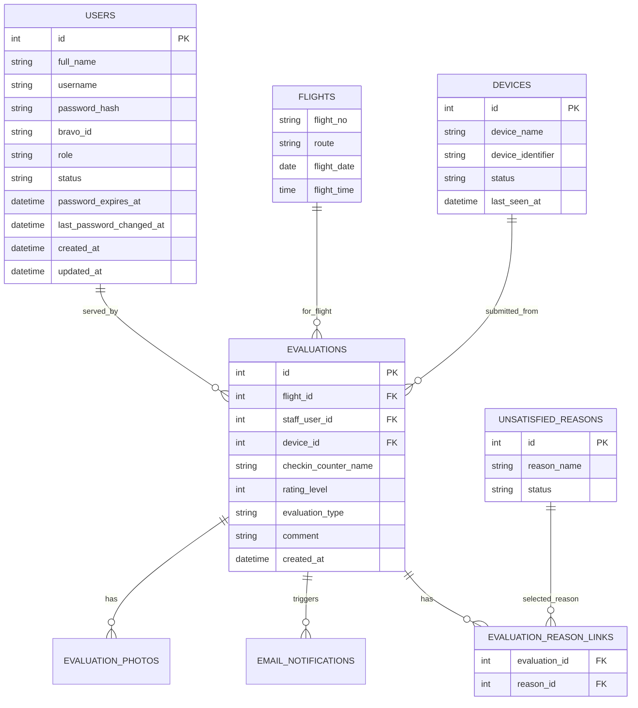

Miêu tả từng bảng trong ERD
1. USERS  
Bảng lưu tài khoản người dùng của hệ thống, gồm cả nhân viên và quản lý.  
Chức năng chính là phục vụ đăng nhập, phân quyền và quản trị tài khoản.  
Các cột chính:
- id: khóa chính
- full_name: họ tên
- username: tên đăng nhập
- password_hash: mật khẩu đã mã hóa
- bravo id
- role: vai trò, ví dụ nhân viên hoặc quản lý
- status: trạng thái tài khoản
- password_expires_at: thời điểm bắt buộc đổi mật khẩu
- last_password_changed_at: lần đổi mật khẩu gần nhất
- created_at: ngày tạo
- updated_at: ngày cập nhật

2. FLIGHTS  
Bảng lưu thông tin chuyến bay mà hành khách đang được phục vụ.  
Dùng để gắn đánh giá vào đúng chuyến bay.  
Các cột chính:
- flight_no: số hiệu chuyến bay
- route: tuyến bay
- flight_date: ngày bay
- flight_time: giờ bay

3. DEVICES  
Bảng lưu các thiết bị được phép chạy màn hình đánh giá.  
Dùng để kiểm soát thiết bị nào có quyền mở form đánh giá cho hành khách.  
Các cột chính:
- id: khóa chính
- device_name: tên thiết bị
- device_identifier: mã định danh thiết bị
- status: trạng thái cho phép hoặc không cho phép
- last_seen_at: thời điểm thiết bị kết nối lần gần nhất

4. EVALUATIONS  
Đây là bảng trung tâm, lưu mỗi lượt đánh giá của hành khách.  
Mỗi bản ghi tương ứng một lần gửi đánh giá hoàn chỉnh.  
Các cột chính:
- id: khóa chính
- flight_id: chuyến bay được đánh giá
- staff_user_id: nhân viên phục vụ
- device_id: thiết bị đã gửi đánh giá
- checkin_counter_name: tên quầy check-in
- rating_level: mức đánh giá từ 1 đến 4
- evaluation_type: loại đánh giá như check-in, boarding, hành lý
- comment: nội dung góp ý nếu có
- created_at: thời điểm đánh giá

5. UNSATISFIED_REASONS  
Bảng danh mục các lý do không hài lòng.  
Chỉ dùng khi hành khách chọn mức đánh giá không hài lòng.  
Các cột chính:
- id: khóa chính
- reason_name: tên lý do
- status: trạng thái sử dụng hoặc ngưng dùng

6. EVALUATION_REASON_LINKS  
Bảng liên kết nhiều-nhiều giữa EVALUATIONS và UNSATISFIED_REASONS.  
Một đánh giá không hài lòng có thể chọn nhiều lý do, và một lý do có thể xuất hiện ở nhiều đánh giá.  
Các cột chính:
- evaluation_id: tham chiếu đến bản ghi đánh giá
- reason_id: tham chiếu đến lý do

